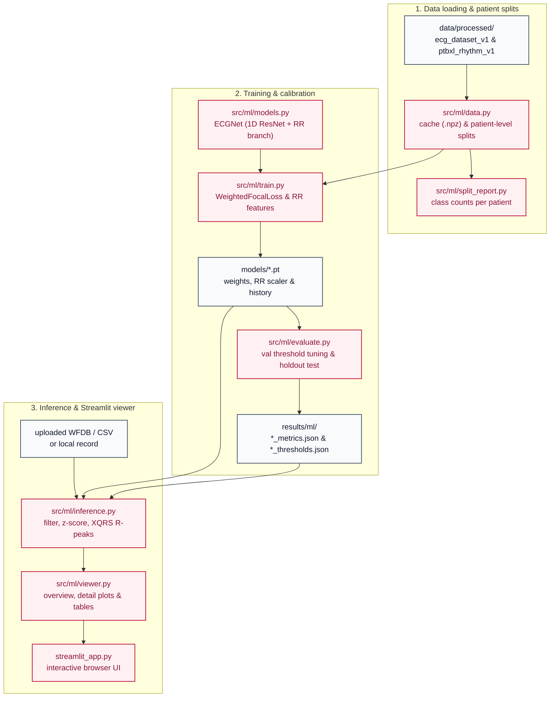
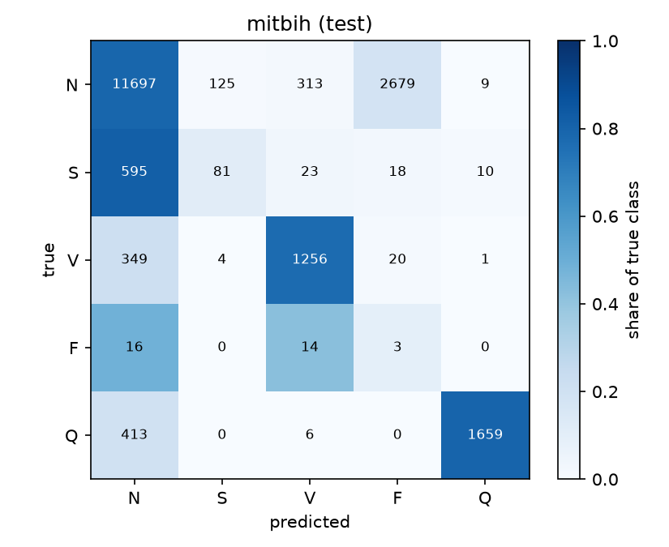
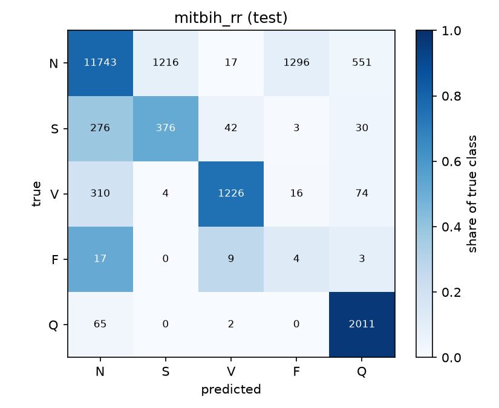
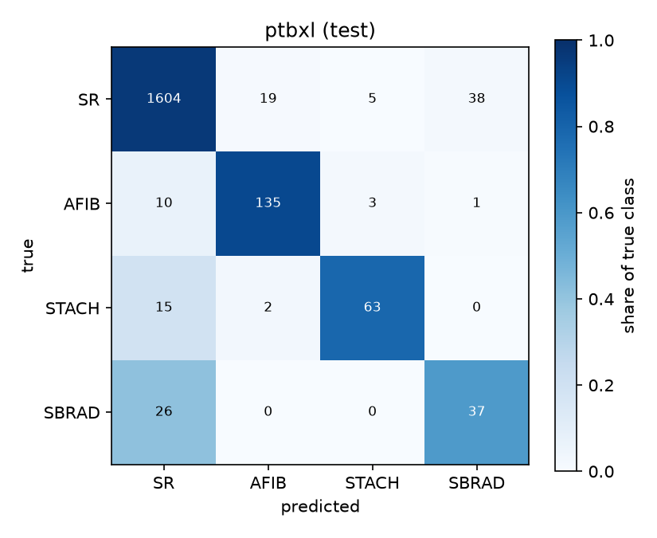

<div align="center">

# ML pipeline: technical documentation


Notes for the modelling part of the project (1D-CNN models, training, metrics, Streamlit app).  
The preprocessing and the data export are described in `README_preprocessing.md` and `ECG_DATA_HANDOFF_FOR_ANNA.md` in the repo root. This file only covers what was added on top of that.

---

[1. Setup](#1-setup-windows-powershell) · [2. Getting the data](#2-getting-the-data) · [3. Loading & splits](#3-loading-the-data-and-the-splits-srcmldatapy) · [4. Models & training](#4-models-and-training) · [5. Evaluation](#5-evaluation-and-threshold-tuning-srcmlevaluatepy)  
[6. Results](#6-results-and-interpretation) · [7. Known issues](#7-known-issues-and-decisions) · [8. Streamlit app](#8-streamlit-app-streamlit_apppy) · [9. Full pipeline](#9-full-pipeline-order-of-commands) · [10. Commits](#10-commit-style)

</div>

---

## 1. Setup (Windows, PowerShell)

Python 3.12 is used (tested with 3.12.10).

```powershell
py -3.12 -m venv .venv
.\.venv\Scripts\Activate.ps1
python -m pip install --upgrade pip
python -m pip install -r requirements_phase4.txt
python -m pip install torch scikit-learn streamlit plotly tqdm pytest
```

All commands below are run from the repo root with the venv active, and with `python -m ...` (not by running the file directly), otherwise the `src` imports do not work.

---

## 2. Getting the data

The `data/` folder is not in git, so every new machine has to build it.

### MIT-BIH

The documented way (`wfdb.dl_database`) did not work here: the download stopped with `RemoteDisconnected` (PhysioNet closed the connection, wfdb downloads many files in parallel). So the whole database was downloaded as one zip file with PowerShell instead.

```powershell
# create the parent folder, Move-Item below needs it
New-Item -ItemType Directory -Force data\mitdb\physionet.org\files\mitdb | Out-Null

# download (about 75 MB, no progress bar shown for visual simplicity)
$ProgressPreference = 'SilentlyContinue'
Invoke-WebRequest -Uri "https://physionet.org/static/published-projects/mitdb/mit-bih-arrhythmia-database-1.0.0.zip" -OutFile mitdb.zip

# unzip and move the folder to the path that the loader expects
Expand-Archive mitdb.zip -DestinationPath mitdb_unzipped
Move-Item mitdb_unzipped\mit-bih-arrhythmia-database-1.0.0 data\mitdb\physionet.org\files\mitdb\1.0.0
```

If an earlier failed download left a `data\mitdb` folder, delete it first (`Remove-Item -Recurse -Force data\mitdb`). The `Move-Item` target (`...\1.0.0`) must not exist yet, otherwise the folder ends up nested one level deeper. Check the files:

```powershell
(dir data\mitdb\physionet.org\files\mitdb\1.0.0\*.hea).Count   # the answer should be 48
(dir data\mitdb\physionet.org\files\mitdb\1.0.0\*.dat).Count   # here 48
(dir data\mitdb\physionet.org\files\mitdb\1.0.0\*.atr).Count   # and here 49 (102-0.atr is the extra one)
```

Then delete the leftovers and build the dataset:

```powershell
Remove-Item -Recurse -Force mitdb.zip, mitdb_unzipped
python -m src.prepare_dataset
```

The script prints one line per record and a summary at the end. Expected summary: 109452 beats, 48 records, 47 patient groups, classes N=90594, S=2781, V=7235, F=802, Q=8040, and `source_files_verified: true`. The output goes to `data/processed/ecg_dataset_v1`. The script refuses to write into a folder that already exists, so to rebuild, delete that folder first.

If the zip download fails too, download it in the browser from [PhysioNet MIT-BIH 1.0.0](https://physionet.org/content/mitdb/1.0.0/) and continue from the `Expand-Archive` step.

### PTB-XL

```powershell
python -m src.ptbxl_bulk                            # dry run, no download
python -m src.ptbxl_bulk --execute --approve-bulk   # about 470 MB
```

Expected result: `status: complete`, 19605 successful, 0 failed. If it stops because of the network, running the same command again continues where it stopped. Output goes to `data/processed/ptbxl_rhythm_v1`.

Be patient, because it does take time. It heavily depends on the machine, but expect 1 hour up to a couple of hours of downloading.

---

## 3. Loading the data and the splits (`src/ml/data.py`)

```powershell
python -m src.ml.data
```

This loads both datasets, builds the splits, checks that no patient is in two parts, and prints a table with the class counts per part.

The first run is slow because it reads every shard (PTB-XL is one file per ECG). It then saves two cache files in `data/processed/cache/`:

- `mitbih_v2.npz` (also holds the R-peak positions, needed for the RR features)
- `ptbxl_v1.npz`

Later runs load the cache. If the exported data is ever rebuilt, delete the cache folder, otherwise the old arrays get loaded. Deleting the cache folder is always safe, it is only a speed-up. `load_mitbih(use_cache=False)` also forces a reload. An old `mitbih_v1.npz` is no longer used and can be deleted.

### Array shapes

<div align="center">

| dataset | X | y | extra |
| :--- | :--- | :--- | :--- |
| MIT-BIH | (109452, 2, 252) float32 | 0..4 = N, S, V, F, Q | `groups`, `record_ids`, `positions` |
| PTB-XL | (19605, 12, 1000) float32 | 0..3 = SR, AFIB, STACH, SBRAD | `patient_id`, `strat_fold`, `ecg_id` |

</div>

MIT-BIH windows are single beats at 360 Hz (0.25 s before and 0.45 s after the R-peak). PTB-XL signals are 10 s at 100 Hz. The two datasets are never mixed, they are different tasks.

### Split protocol

Rule for everything: the split is by patient, never by beat or by ECG.

- MIT-BIH: 70/15/15 by patient group (47 groups). The groups are shuffled with a fixed seed (`seed=42`) until every part has at least 20 beats of every class, because S and F beats are concentrated in a few patients. Records 201 and 202 belong to the same patient and share one group.
- PTB-XL: the official `strat_fold` column: folds 1-8 train, fold 9 validation, fold 10 test. This is the split recommended by the dataset authors and it already keeps patients apart. `assert_no_leakage` checks the patient ids as well.

### Reproducibility

The MIT-BIH split is deterministic. Running the code again gives exactly the same split as long as the data and these parameters stay the same: `seed`, `val_frac`, `test_frac`, `min_per_class`. If you wish to change the training, or just run it after the training, then do not change them after training has started, otherwise results from different runs cannot be compared. The `--seed` of the training script only changes the model initialisation and batch order, not the split. The PTB-XL split has no randomness at all.

<div align="center">

| dataset | part | n | class distribution |
| :--- | :--- | :---: | :--- |
| MIT-BIH | train | 72839 | N: 62837, S: 1953, V: 3783, F: 395, Q: 3871 |
| MIT-BIH | val | 17322 | N: 12934, S: 101, V: 1822, F: 374, Q: 2091 |
| MIT-BIH | test | 19291 | N: 14823, S: 727, V: 1630, F: 33, Q: 2078 |
| PTB-XL | train | 15689 | SR: 13354, AFIB: 1189, STACH: 643, SBRAD: 503 |
| PTB-XL | val | 1958 | SR: 1667, AFIB: 146, STACH: 82, SBRAD: 63 |
| PTB-XL | test | 1958 | SR: 1666, AFIB: 149, STACH: 80, SBRAD: 63 |

</div>

---

## 4. Models and training

Files: `src/ml/models.py` (model), `src/ml/train.py` (training loop).

### ML codebase overview

<div align="center">



</div>

### Architecture (`ECGNet`)

One 1D-CNN for both datasets: a stem convolution (kernel 7), three residual blocks (32, 64, 128 channels, kernel 7, stride 1/2/2, BatchNorm, LeakyReLU), global average pooling, then a head `Linear(64) - LeakyReLU - Dropout(0.4) - Linear(classes)`. When RR features are enabled, 30% modality dropout (`rr_dropout=0.3`) is applied to the RR branch during training so the network still has to look at waveform morphology (like pacemaker spikes) and cannot rely only on beat timing. It returns logits, softmax is applied outside.

<div align="center">

| model | input | classes | parameters | best epoch |
| :--- | :---: | :---: | :---: | :---: |
| MIT-BIH baseline | 2 x 252 | 5 | 249,989 | 9 of 17 |
| MIT-BIH + RR features | 2 x 252 + 5 features | 5 | 250,309 | 7 of 15 |
| PTB-XL | 12 x 1000 | 4 | 252,164 | 7 of 15 |

</div>

### Training setup

`WeightedFocalLoss` (`--focal-gamma`, default 1.5), with class weights `weights = clip((n_train / (k * count_c)) ** 0.5, max=10.0)` computed on the training part only (power 0.5 is softer than fully balanced, otherwise the rarest class gets a huge weight). Adam, lr 1e-3, weight decay 1e-4, batch size 256, at most 40 epochs, seed 42. The best epoch is chosen by validation macro F1, training stops after 8 epochs without improvement. The test split is never used in training. On my CPU it took about 90-115 s per epoch for MIT-BIH and about 70 s for PTB-XL (no GPU is used, the CPU is sufficient for this model size).

### RR timing features (MIT-BIH only, `--rr`)

A single beat window cannot show whether a beat came early. For every beat, 5 features are computed from the R-peak positions of the neighbouring beats in the same recording: pre-RR and post-RR interval (s), mean of the last 10 intervals, and the two ratios to that mean. The first/last beat of a recording reuse the neighbouring interval. The features are standardised with the training part only (mean and std are saved in the checkpoint). Nothing comes from other patients, so there is no leakage across the split. The app gets the positions from an R-peak detector.

---

## 5. Evaluation and threshold tuning (`src/ml/evaluate.py`)

```powershell
# tune thresholds on validation
python -m src.ml.evaluate --dataset mitbih --name mitbih --split val --tune-thresholds
python -m src.ml.evaluate --dataset mitbih --name mitbih_rr --split val --tune-thresholds
python -m src.ml.evaluate --dataset ptbxl --split val --tune-thresholds

# run final evaluation on test once
$env:FORCE_RETEST="1"
python -m src.ml.evaluate --dataset mitbih --name mitbih --split test --allow-final-test
python -m src.ml.evaluate --dataset mitbih --name mitbih_rr --split test --allow-final-test
python -m src.ml.evaluate --dataset ptbxl --split test --allow-final-test
Remove-Item Env:FORCE_RETEST
```

Reports accuracy, per-class precision / recall / specificity / F1 / AUPRC, the macro averages (plain mean over classes), the confusion matrix, and the inference time for one sample at a time on CPU. Specificity and AUPRC are one-vs-rest per class (AUPRC from the softmax probabilities). Results are saved in `results/ml/` as JSON and a confusion matrix PNG.

`--tune-thresholds` runs a bounded coordinate search on validation probabilities to find per-class thresholds that maximise macro F1, and saves them in `results/ml/<name>_thresholds.json`. When `--split test` runs, it loads those saved thresholds without touching test labels. `--split test` also refuses to run without `--allow-final-test` and will not overwrite an existing test JSON unless `FORCE_RETEST=1` is set.

---

## 6. Results and interpretation

### Validation vs test overview

<div align="center">

| model | split | accuracy | macro recall | macro specificity | macro F1 | macro AUPRC | inference (ms, CPU, 1 sample) |
| :--- | :---: | :---: | :---: | :---: | :---: | :---: | :---: |
| MIT-BIH baseline | val | 0.918 | 0.659 | 0.968 | 0.624 | 0.625 | 1.40 |
| MIT-BIH baseline | test | 0.762 | 0.512 | 0.905 | 0.534 | 0.594 | 1.40 |
| MIT-BIH + RR | val | 0.893 | 0.625 | 0.961 | 0.595 | 0.613 | 1.42 |
| MIT-BIH + RR | test | 0.796 | 0.630 | 0.935 | 0.575 | 0.638 | 1.41 |
| PTB-XL | val | 0.955 | 0.874 | 0.966 | 0.854 | 0.898 | 4.99 |
| PTB-XL | test | 0.939 | 0.811 | 0.947 | 0.805 | 0.847 | 3.52 |

</div>

### Held-out test breakdown

#### 1. MIT-BIH baseline on test (19291 beats)

<table>
<tr>
<td width="52%" valign="middle">

| class | n | precision | recall | specificity | F1 | AUPRC |
| :---: | :---: | :---: | :---: | :---: | :---: | :---: |
| N | 14823 | 0.895 | 0.789 | 0.693 | 0.839 | 0.924 |
| S | 727 | 0.386 | 0.111 | 0.993 | 0.173 | 0.179 |
| V | 1630 | 0.779 | 0.771 | 0.980 | 0.775 | 0.873 |
| F | 33 | 0.001 | 0.091 | 0.859 | 0.002 | 0.002 |
| Q | 2078 | 0.988 | 0.798 | 0.999 | 0.883 | 0.989 |

</td>
<td width="48%" align="center" valign="middle">

<br><sub><em>Figure 1: MIT-BIH baseline confusion matrix on test.</em></sub>
</td>
</tr>
</table>

#### 2. MIT-BIH + RR features on test (19291 beats)

<table>
<tr>
<td width="52%" valign="middle">

| class | n | precision | recall | specificity | F1 | AUPRC |
| :---: | :---: | :---: | :---: | :---: | :---: | :---: |
| N | 14823 | 0.946 | 0.792 | 0.850 | 0.862 | 0.974 |
| S | 727 | 0.236 | 0.517 | 0.934 | 0.324 | 0.347 |
| V | 1630 | 0.946 | 0.752 | 0.996 | 0.838 | 0.933 |
| F | 33 | 0.003 | 0.121 | 0.932 | 0.006 | 0.002 |
| Q | 2078 | 0.753 | 0.968 | 0.962 | 0.847 | 0.932 |

</td>
<td width="48%" align="center" valign="middle">

<br><sub><em>Figure 2: MIT-BIH + RR features confusion matrix on test.</em></sub>
</td>
</tr>
</table>

#### 3. PTB-XL on test (1958 ECGs)

<table>
<tr>
<td width="52%" valign="middle">

| class | n | precision | recall | specificity | F1 | AUPRC |
| :---: | :---: | :---: | :---: | :---: | :---: | :---: |
| SR | 1666 | 0.969 | 0.963 | 0.825 | 0.966 | 0.993 |
| AFIB | 149 | 0.865 | 0.906 | 0.988 | 0.885 | 0.908 |
| STACH | 80 | 0.887 | 0.787 | 0.996 | 0.834 | 0.881 |
| SBRAD | 63 | 0.487 | 0.587 | 0.979 | 0.532 | 0.605 |

</td>
<td width="48%" align="center" valign="middle">

<br><sub><em>Figure 3: PTB-XL confusion matrix on test (fold 10).</em></sub>
</td>
</tr>
</table>

### Reading the results

- PTB-XL generalises as expected. Test macro F1 is 0.805 compared to 0.854 on validation. AFIB (F1 0.885, recall 90.6%) and STACH (F1 0.834) work well; SBRAD is the weakest class (F1 0.532) and as Figure 3 shows, it is almost only confused with SR, which is just a heart-rate boundary.
- On MIT-BIH, training macro F1 reaches about 0.93-0.95 while validation stays around 0.55-0.62 and jumps between epochs. Because validation S, F and Q are each dominated by one patient (section 7), validation differences on rare classes cannot be trusted much.
- On the held-out test split, `mitbih_rr` beats the signal-only baseline overall: macro F1 goes from 0.534 to 0.575, macro AUPRC from 0.594 to 0.638, and accuracy from 76.2% to 79.6%.
- RR features help the classes spread across several patients. On test, S is spread over 6+ records and `mitbih_rr` improves S F1 from 0.173 to 0.324 (recall 11.1% -> 51.7%, AUPRC 0.179 -> 0.347) and V F1 from 0.775 to 0.838 (AUPRC 0.873 -> 0.933). That supports the idea that beat timing matters for premature beats.
- Adding 30% modality dropout on the RR branch (`rr_dropout=0.3`) stopped the model from ignoring pacemaker spikes in the waveform. Without it, regular paced beats in record 107 looked normal in timing and Q F1 collapsed to 0.055; with dropout, Q stays at F1 0.847 (96.8% recall).
- Class F is not recognised by either model (F1 <= 0.006, 33 beats from 5 records), and both models falsely label many normal beats as F (2679 in baseline, 1296 in RR). F was learned mostly from one training patient (record 213), so F predictions in the app must not be trusted.

---

## 7. Known issues and decisions

### MIT-BIH: very few patients behind the rare classes

`python -m src.ml.split_report` lists which records hold the beats of each class in each split (records with the most beats, beats in brackets):

<div align="center">

| class | train | validation | test |
| :--- | :--- | :--- | :--- |
| S | 232 (1382 of 1953), 222 (209), 207 (107) | 118 (96 of 101) | 209 (383), 201 (128), 223 (73), 202 (55), 234 (50), 124 (31) |
| F | 213 (362 of 395), 205 (11), 210 (10) | 208 (372 of 374) | 223 (14), 233 (11), 124 (5), 201 (2), 202 (1) |
| Q | 104 (2062), 217 (1802) | 102 (2083 of 2091) | 107 (2078 of 2078) |
| V | 200 (826), 106 (520), 119 (444) | 208 (992), 203 (444), 214 (256) | 233 (830), 223 (473), 201 (198) |

</div>

Split sizes: 33 records in train, 7 in validation, 8 in test.

Consequences:

- Validation S is mostly one patient (118), validation F is one patient (208), validation Q is one patient (102), and test Q is one patient (107). The test set also has only 33 F beats across 5 records.
- Class F in training is mostly one patient (213). Class Q comes from the four paced-rhythm records of the database (102, 104, 107, 217), so "Q" is mostly paced beats.
- This is a property of MIT-BIH (47 patients), not a bug: no patient-wise split can give every rare class many patients in every part.

### Model choice for MIT-BIH

Both models (`mitbih` baseline and `mitbih_rr`) are evaluated on the test split and reported side by side. The app uses `mitbih_rr` as default (and lets the user switch between both models) because it gives much better sensitivity on ectopic S and V beats and higher overall test macro F1 (0.575 vs 0.534) and macro AUPRC (0.638 vs 0.594).

### Other limits worth mentioning

- Both datasets are heavily imbalanced (MIT-BIH: N is about 83 percent, F under 1 percent; PTB-XL: SR is about 85 percent). Class weights are computed from the training part only; validation and test are never rebalanced.
- The two MIT-BIH channels are not always the same lead (for example record 114 is V5/MLII, some records use V2 or V4 instead of V1).
- Preprocessing was done offline on whole recordings (zero-phase filter, per-recording z-score), so it is not causal.
- No 50 Hz notch filter was used. At 100 Hz sampling it would sit at the Nyquist frequency, and for MIT-BIH the residual powerline noise was measured and found small.
- Each model was trained once (seed 42), the variation between seeds was not measured.
- In the app the beats come from an automatic R-peak detector (`wfdb` XQRS) and not from expert annotations as in training, so the windows can be shifted by a few samples. Files with another sampling rate can be resampled, which the models never saw in training.

---

## 8. Streamlit app (`streamlit_app.py`)

```powershell
streamlit run streamlit_app.py
```

Run from the repo root with the venv active. It opens in the browser and needs the trained checkpoints in `models/` plus the saved thresholds in `results/ml/`.

### How I split the code

- `streamlit_app.py` - the Streamlit page itself and all the UI controls
- `src/ml/inference.py` - reading files, signal quality checks, preprocessing, and running the models
- `src/ml/viewer.py` - building the Plotly figures and summary tables
- `.streamlit/config.toml` - colours

I kept all Streamlit calls out of `inference.py` and `viewer.py` on purpose so I could unit-test them directly without launching the app (`tests/test_ml_pipeline.py`, `tests/test_inference.py`, `tests/test_viewer.py`). I tested the UI with Streamlit 1.67 because it uses `st.fragment` and clickable table rows.

### Layout of the page

I put all inputs in the sidebar so the main area stays focused on the signal:

- You can upload a WFDB record (`.hea` and `.dat` together), upload a `.csv` (one column per lead, with the sampling rate typed in), or just pick a local record from `data/`.
- I made it detect the task automatically from the lead count: 2 leads run beat-by-beat classification (MIT-BIH models), and 12 leads run 10 s window classification (PTB-XL model).
- Under "Advanced", there is optional resampling (off by default, because the models never saw resampled data in training) and a cap on how much of the recording gets analysed (default 30 min).

From top to bottom, the main page shows:

1. Summary: total beats (or windows), estimated heart rate, how many events were flagged (count and percentage), and the breakdown per class.
2. Overview of the whole recording: the filtered signal of the chosen lead across the full recording, with a flag timeline underneath (flagged beats per time bin and class, or a rhythm ribbon across every 10 s window). The stretch currently shown below is highlighted in blue.
3. Navigation controls: a position slider, "Previous flagged" / "Next flagged" buttons, lead selector, and window length.
4. Detail view: raw and filtered waveform of the selected stretch. In beat mode, R-peaks are shown as dots and flagged beats get their class letter and a light red highlight. In rhythm mode, each 10 s window is shaded by its predicted class, and I added a "Show all 12 leads" toggle if you want to inspect all leads stacked vertically.
5. Flagged events table (on the right): you can filter by class (or include normal `N` / `SR` events), click any row to jump straight to that timestamp, and export the whole table as a CSV.
6. "About the model": displays the held-out test metrics for whichever model is active (loaded from `results/ml/<model>_test_metrics.json`) along with its caveats.

### Preprocessing, speed, and safety checks

- I reused the exact same preprocessing code as in training: bandpass filter on the whole recording (0.5-45 Hz, order 4, zero-phase, no 50 Hz notch), z-score per lead, then 90 samples before and 162 after each R-peak (or 10 s windows for rhythm). `tests/test_inference.py` checks that this matches `src/preprocessing.py` and `src/segmentation.py`.
- I wanted scrolling through long recordings to feel snappy, so filtering, R-peak detection, and model inference run once per recording and settings change instead of on every click. The slider, buttons, and table live inside a `st.fragment` so only that part redraws when you move around. On a 30-minute, 2-lead recording (648,000 samples), the one-time analysis took about 3.5 s on my machine and redrawing both charts takes about 35 ms.
- I added a check in `classify_rhythm()` that inspects each 10 s window after z-score normalisation and skips flatline or NaN segments so dead leads do not produce bogus predictions. For records from the original datasets, the app also checks the cache from `python -m src.ml.data` (cached with `lru_cache`) and tells you whether that record was in train, validation, or test, since performance on a training patient is naturally better than on a new one.

### Limits

- "Flagged" just means any prediction other than `N` (beat mode) or `SR` (rhythm mode) - I did not add any clinical rules or episode grouping on top, so a run of `V` beats shows up as individual beats.
- Class `F` predictions are not reliable (section 6) and should not be trusted.
- This is a prototype, not a medical device.

---

## 9. Full pipeline (order of commands)

<details>
<summary>Click to expand full command list (PowerShell)</summary>

```powershell
# setup (once)
py -3.12 -m venv .venv
.\.venv\Scripts\Activate.ps1
python -m pip install --upgrade pip
python -m pip install -r requirements_phase4.txt
python -m pip install torch scikit-learn streamlit plotly tqdm pytest

# data (once, MIT-BIH via the zip as described in section 2)
python -m src.prepare_dataset
python -m src.ptbxl_bulk --execute --approve-bulk

# loading, splits, who is in which split
python -m src.ml.data
python -m src.ml.split_report

# unit tests
python -m pytest -v tests/test_ml_pipeline.py tests/test_inference.py tests/test_viewer.py

# training
python -m src.ml.train --dataset mitbih --name mitbih
python -m src.ml.train --dataset mitbih --rr --name mitbih_rr
python -m src.ml.train --dataset ptbxl

# validation and threshold tuning
python -m src.ml.evaluate --dataset mitbih --name mitbih --split val --tune-thresholds
python -m src.ml.evaluate --dataset mitbih --name mitbih_rr --split val --tune-thresholds
python -m src.ml.evaluate --dataset ptbxl --split val --tune-thresholds

# test, once, after all decisions
$env:FORCE_RETEST="1"
python -m src.ml.evaluate --dataset mitbih --name mitbih --split test --allow-final-test
python -m src.ml.evaluate --dataset mitbih --name mitbih_rr --split test --allow-final-test
python -m src.ml.evaluate --dataset ptbxl --split test --allow-final-test
Remove-Item Env:FORCE_RETEST

# app
streamlit run streamlit_app.py
```

</details>

---

## 10. Commit style

Conventional Commits: `type(scope): short description`, for example `feat(data): add loaders and patient-separated splits`.

- types: `feat`, `fix`, `docs`, `test`, `refactor`, `perf`, `chore`, `build`
- scopes: `data`, `models`, `train`, `eval`, `inference`, `app`
